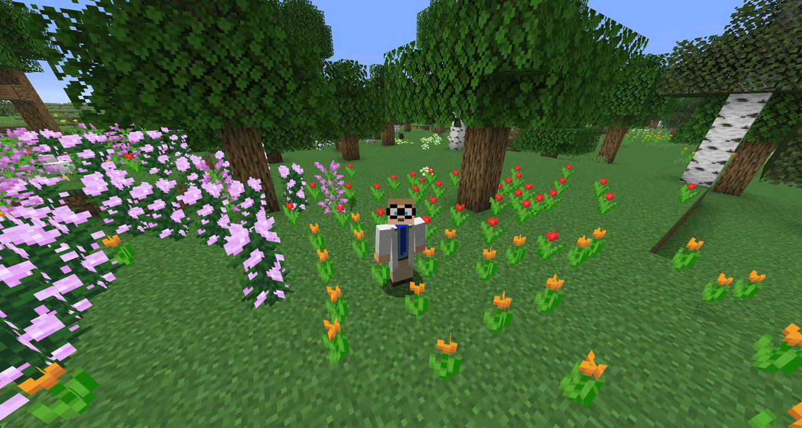
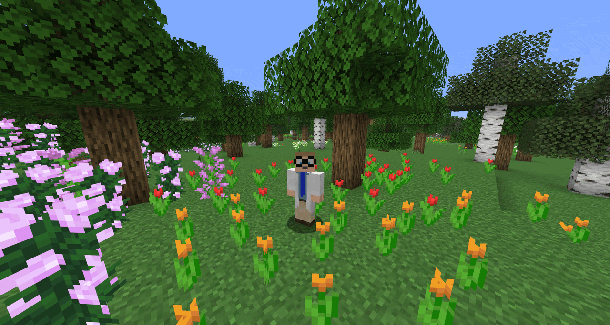
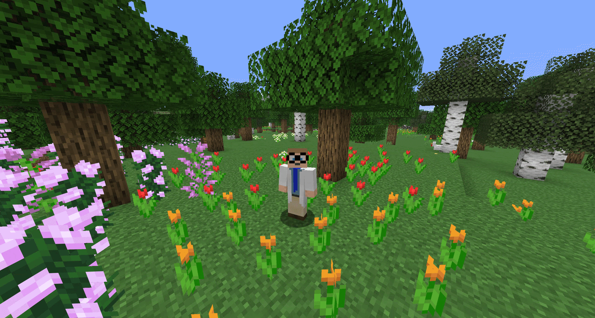
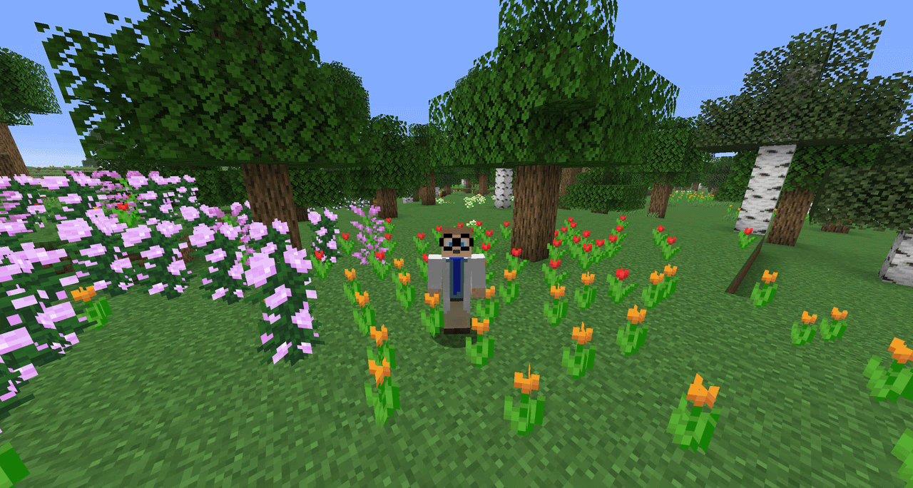

# Simple Voice Animations

This repository is a NeoForge port of the original [Simple Voice Animations](https://github.com/henkelmax/simple-voice-animations) mod by Max Henkel.

The original project and its assets are retained in this fork. The NeoForge port adapts the mod to Minecraft 1.21.1 while preserving its animation styles and Simple Voice Chat integration.

## Animation Styles

**Squish** - The head squishes while talking.



**Scale Height** - The head stretches vertically while talking.



**Scale** - The whole head scales up and down while talking.


**Split Head (Hinge)** - The head splits open like a jaw.


**Split Head (Vertical)** - The upper part of the head lifts straight up.


*The split height is configurable for both split styles.*

**Nod** - The head nods while talking.



## Usage

Press `J` (configurable in the Minecraft key bindings) to open the settings screen.
Choose your animation style and drag the bar in the preview to set where your head splits.

## Requirements

- Minecraft 1.21.1
- NeoForge 21.1.264 or a compatible 1.21.1 release
- [Simple Voice Chat](https://modrinth.com/mod/simple-voice-chat) for NeoForge

## Development

Build the mod:

```powershell
.\gradlew.bat build
```

Start the NeoForge development client:

```powershell
.\gradlew.bat runClient
```

The built JAR is written to `build/libs` with the `-neoforge` suffix, for example
`simplevoiceanimations-neoforge-1.0.0.jar`.

## Credits and fork information

The original mod, animation concepts, documentation, and demonstration assets are by [Max Henkel](https://github.com/henkelmax).
The original source project is available at [henkelmax/simple-voice-animations](https://github.com/henkelmax/simple-voice-animations).

This fork contains the NeoForge port and related changes for Minecraft 1.21.1. Please refer to the upstream project's licensing terms before redistributing it.
